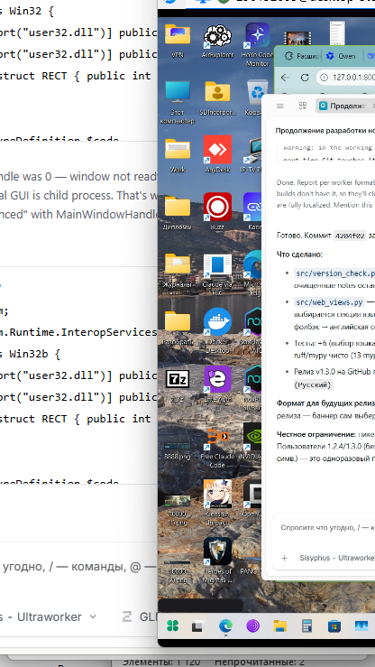

# AntiVKGroup Vanced

**🇬🇧 English** | [🇷🇺 Русский](README.ru.md) | [🇺🇦 Українська](README.uk.md) | [🇰🇿 Қазақша](README.kk.md) | [🇩🇪 Deutsch](README.de.md) | [🇫🇷 Français](README.fr.md) | [🇪🇸 Español](README.es.md) | [🇵🇱 Polski](README.pl.md) | [🇹🇷 Türkçe](README.tr.md) | [🇨🇳 中文](README.zh.md)

## 🌐 Forks

<a href="https://github.com/retvil/AntiBaiduVanced"> AntiBaiduVanced</a>  |  <a href="https://github.com/retvil/AntiSogouVanced"> AntiSogouVanced</a>  |  <a href="https://github.com/retvil/Anti2345Vanced"> Anti2345Vanced</a>  |  <a href="https://github.com/retvil/AntiUCWebVanced"> AntiUCWebVanced</a>  |  <a href="https://github.com/retvil/AntiNaverVanced"> AntiNaverVanced</a>  |  <a href="https://github.com/retvil/AntiKakaoVanced"> AntiKakaoVanced</a>  |  <a href="https://github.com/retvil/AntiQQVanced"> AntiQQVanced</a>  |  <a href="https://github.com/retvil/AntiWeChatVanced"> AntiWeChatVanced</a>  |  <a href="https://github.com/retvil/AntiTencentVideoVanced"> AntiTencentVideoVanced</a>  |  **AntiVKGroupVanced**  |  <a href="https://github.com/retvil/AntiYandexVanced"> AntiYandexVanced</a>

## Bu nedir?

Mail.ru (VK Group) uygulamalarını sadece kurmuyor — Agent, VK Messenger, Cloud Mail.ru ve go.mail.ru araması onlarca sistem mekanizması üzerinden sessizce kendini kaydediyor: kayıt defteri ilişkilendirmeleri, kurumsal ilkeler, tarayıcı profili ayarları, hatta Chromium profillerinin içindeki arama motoru veritabanları. Uygulamaları kaldırmak tek başına bunların hepsini geri almıyor.

**AntiVKGroup Vanced** ([AntiYandexVanced](https://github.com/retvil/AntiYandexVanced) projesinin kardeşi) **37 vektörün tamamını** buluyor, tek tıkla kaldırıyor ve ardından varsayılan aramanızı Windows kurumsal ilkeleri aracılığıyla seçtiğiniz motora **katı şekilde kilitliyor** — hiçbir şey onu sessizce geri alamıyor.

## Özellikler

- **Ele geçirme tarayıcısı** — 37 vektörü tespit eder: kurulum yolları, kaldırma kayıt defteri girdileri, `StartMenuInternet` kayıtları, `Software\Mail.Ru` anahtar ağaçları, `DefaultSearchProvider*` ilke ele geçirmesi, Chromium profili `Preferences`, `Web Data` SQLite anahtar kelimeleri, Firefox `search.json.mozlz4`, eski `SearchScopes`, otomatik başlatma girdileri, zamanlanmış görevler, Windows hizmetleri, kısayollar, ProgramData/Roaming kalıntıları, hosts girdileri, güvenlik duvarı kuralları, URI protokolleri, tarayıcı uzantıları, mail.ru çerezleri, «Birlikte aç» ilişkilendirmeleri, Prefetch/WER izleri, Defender istisnaları, IE başlangıç sayfası ele geçirmesi, başlangıç URL ilkeleri (`RestoreOnStartupURLs`), Firefox ana sayfası, IE bölge haritası, RegisteredApplications girdileri, MUICache izleri, %TEMP% kurulumcuları — ayrıca Extended sürümünde: kabuk kaplamaları, bağlam menüleri, artan dizinler, Store uygulamaları (ICQ, TamTam, VK Play), ürün dizinleri ve yerel veri dizinleri
- **Tek tıkla kaldırma** — tespit edilen her vektör özel bir kaldırıcıyla kaldırılır; kilitli veritabanları raporlanır, asla çökmez
- **Katı arama ilkesi** — varsayılan aramayı 10 motordan birine (Google, Bing, DuckDuckGo, Brave Search, Startpage, Mojeek, Qwant, Ecosia, Yahoo, SearXNG) Chrome, Edge, Brave, Vivaldi ve Opera için HKLM ilkeleriyle, Firefox/Waterfox için `policies.json` ile kilitler
- **İlke temizliği** — Mail.ru `DefaultSearchProvider*` değerlerini kayıt defterinden temizler
- **Kullanıcı verisi onayı** — kişisel veri içeren öğeler (Cloud Mail.ru dosyaları, ICQ/TamTam geçmişi, uzantılar, çerezler, Defender istisnaları) asla açık onay olmadan silinmez
- **İstisnalar** — işaretlenmemiş bulgular kaydedilebilir; gelecekteki taramalarda otomatik olarak işaretten çıkarılır
- **Yedekler** — her kayıt defteri anahtarı ve dosya silmeden önce `%APPDATA%\AntiVKGroupVanced\backup\` içine aktarılır, ayrıca tam işlem günlüğü
- **10 arayüz dili** — ru, en, uk, kk, de, fr, es, pl, tr, zh; sistem dili otomatik algılanır
- **Hafif arayüz** — ttkbootstrap, dikey düzen, sabitlenmiş durum çubuğu ve alt bilgi

## Ekran görüntüsü

<details>
<summary>Ana pencere</summary>



</details>

## Hazır derlemeler

[Releases](https://github.com/retvil/AntiVKGroupVanced/releases) sayfasından indirin:

- **Windows** — `AntiVKGroupVanced.exe` (taşınabilir, tek dosya, ~35 MB) — yalnızca Mail.ru Agent ve VK Messenger'ı kaldırır
- **Windows** — `AntiVKGroupExtended.exe` (taşınabilir, tek dosya, ~35 MB) — tüm Mail.ru / VK ürünlerinin kaldırılması: Cloud Mail.ru, ICQ, TamTam, VK Play, My.com, Store uygulamaları, ürün dizinleri, yerel veri dizinleri, sistem genelinde izler

Her iki sürüm de aynı kod tabanından derlenir — kurulu yazılımınıza uyan olanı seçin. **Yönetici olarak** çalıştırın — HKLM ilkeleri ve kayıt defteri temizliği yükseltilmiş haklar gerektirir.

## Kaynaktan kurulum

Python 3.10+ gerekir ([python.org](https://python.org)).

```bash
git clone https://github.com/retvil/AntiVKGroupVanced.git
cd AntiVKGroupVanced
pip install psutil ttkbootstrap
python main.py
```

Kendi EXE'nizi derleyin: `build.bat` çalıştırın (PyInstaller, çıktı `dist/` içinde).

## Kullanım

1. **Süreçleri öldür** → **Ara** → **Sil** — uygulamaların kendisini kaldırır.
2. **Arama ele geçirmelerini tara** — go.mail.ru'nun sisteme girdiği her yolu listeler.
3. **Ele geçirmeleri kaldır** — önce tüm tarayıcıları kapatın, sonra bulunan her şeyi kaldırın.
4. Bir motor seçin → **İlkeyi uygula** — varsayılan aramanız artık sistem genelinde kilitli.
5. **Mail.ru ilkelerini kaldır** — 4. adımı geri almak isterseniz Mail.ru arama ilke değerlerini kaldırır.

## SSS

- **Neden yönetici?** Varsayılan arama ilkeleri HKLM'de yaşar ve ele geçirme temizliği sistem kayıt defterine dokunur — ikisi de yükseltilmiş hak gerektirir.
- **Sonuçlarda «Veritabanı kilitli»?** Temizlik sırasında bir Chromium tarayıcısı çalışıyordu. Tüm tarayıcıları kapatın ve kaldırmayı tekrarlayın.
- **Arama ilkesini nasıl geri alırım?** **Mail.ru ilkelerini kaldır** düğmesi ilke değerlerini kaldırır; Firefox kullanıcıları `distribution\policies.json` dosyasını da silebilir.
- **Uygulama neden onay istiyor?** Bazı bulgular kişisel veri içerir (Cloud Mail.ru dosyaları, mesajlaşma geçmişi, çerezler). Asla açık onayınız olmadan silinmezler.
- **Hangi sürüme ihtiyacım var?** Sadece Agent / VK Messenger kuruluysa → `AntiVKGroupVanced.exe`. Mail.ru / VK ailesinden başka bir şey varsa (Cloud, ICQ, TamTam, VK Play, My.com) → `AntiVKGroupExtended.exe`.

## Yazar ve destek

**Nod33Eset** — [AntiYandexVanced](https://github.com/retvil/AntiYandexVanced) projesinin kardeşi. Issues ve PR'lere açığız.

Araç sizi Mail.ru'dan kurtardıysa, geliştirmeyi destekleyebilirsiniz:

**Kripto:**

- BTC: `bc1qunld3rsp37qf5gg69aune50y0qqkd0eugg7j97`
- TON: `UQDmvr4SKOxSION3Yky6aOgwAnCDXySPuAbG4EKJa5JUT7tC`
- USDT (TRC20): `TBPJSSLu1mUcX54g9UyxUohYGf2fuRvbwd`
- USDT (ERC20): `0x25CAED3776Ef5b18E03392bC5b254Bbd78E8180C`
- USDT (SOL): `3qgN5z291CEcj2FUi2Zza5DioxKgNw72kC7P52pCcTrG`

## Lisans

MIT — bkz. [LICENSE](LICENSE).


